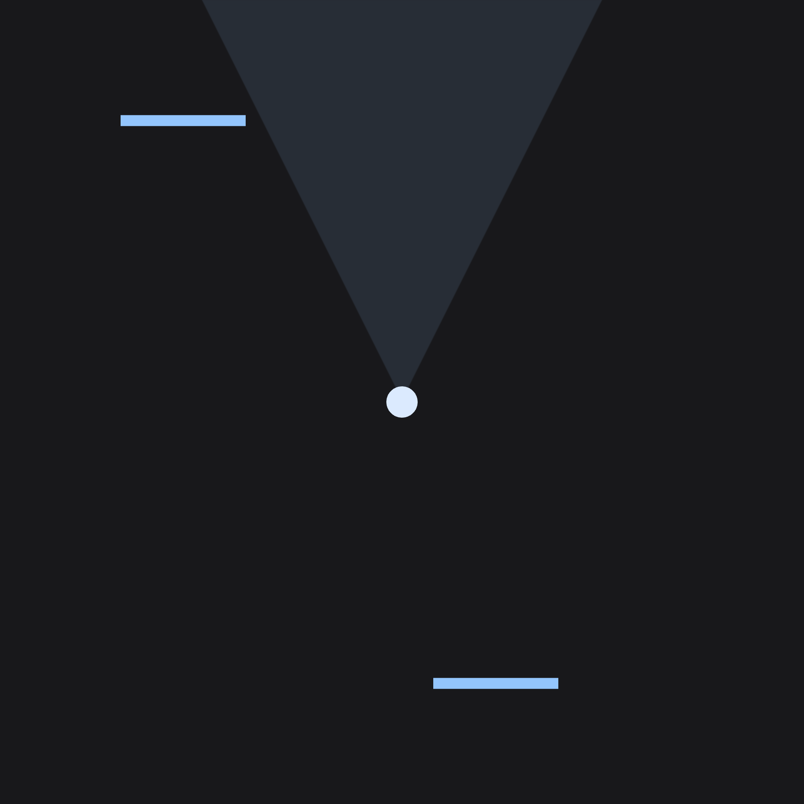
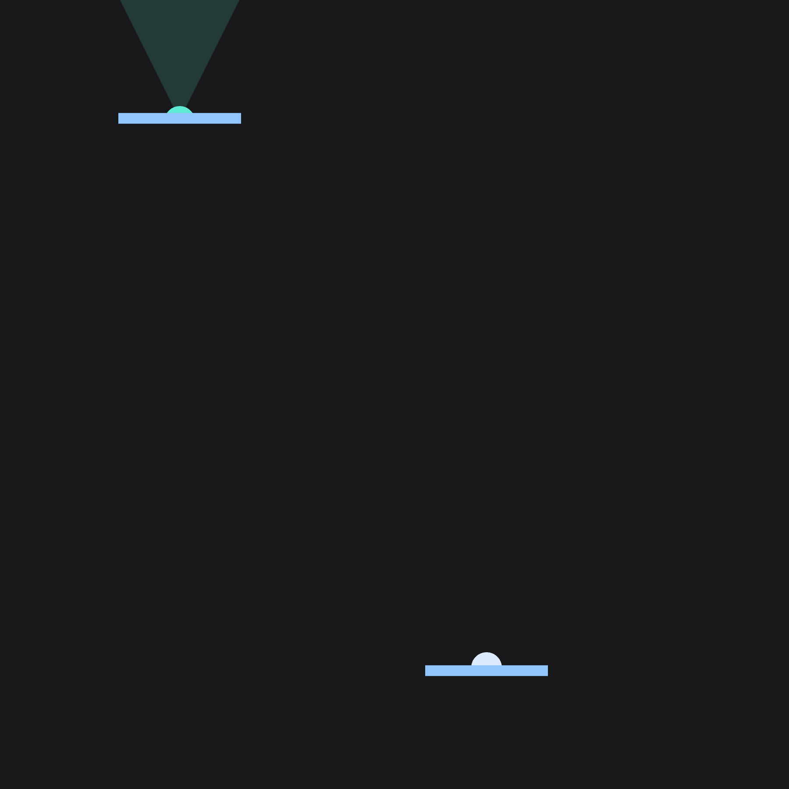
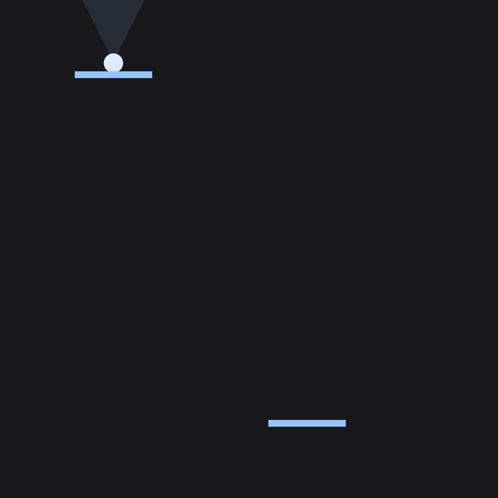

# Portal Demo 2D

A native macOS experiment for exploring portal movement and visibility on a flat 2D canvas, built with Swift and Metal.



*The starting scene: a circular player, its viewing cone, and two connected portal openings.*

[Quick start](#quick-start) · [Controls](#controls) · [Screenshots](#screenshots) · [How it works](#how-it-works) · [Rendering guide](Docs/RenderingGuide.md)

## What you can explore

- Move the player and its viewing cone together with **WASD**.
- Turn the viewing cone independently with **Q / E**.
- Cross either portal and emerge from the other, with the movement controls rotating through the same connection.
- Watch mapped green copies show the parts of the player and view that appear through an opening.
- Edit the scene's objects, colors, sizes, smoothing, and movement speeds in code.

This is a portal experiment with center-crossing and aperture-fit checks. Full-body collision handling and recursive portal views are not implemented.

## Quick start

### Requirements

- A Mac running **macOS 14 or later**, with a Metal-capable GPU.
- The full **Xcode** app, including its Metal toolchain. This checkout builds with Xcode 27.0.
- Git and [GitHub CLI](https://cli.github.com/) for the clone command below, signed in to an account with repository access.

The application has no third-party packages, backend, or API keys.

### Run in Xcode

```sh
gh repo clone safuentees/portal-demo-2d
cd portal-demo-2d
open MetslStarter.xcodeproj
```

1. Select the **MetslStarter** scheme and **My Mac** as the destination.
2. Press **Command-R** to build and run.
3. In the **Metsl Starter** window, click the canvas to focus it and use the controls below.

The project and application retain the name `MetslStarter`. The current app version is **1.0.0**, build **1**; see the [changelog](CHANGELOG.md).

## Controls

| Action | Control |
| --- | --- |
| Focus the scene | Click the canvas |
| Move the player and viewing cone | **W / A / S / D** |
| Turn the viewing cone counterclockwise | Hold **Q** |
| Turn the viewing cone clockwise | Hold **E** |
| Cancel rotation | Hold **Q** and **E** together |
| Stop movement or rotation | Release the keys or switch windows |
| Restore the initial scene | Close and reopen the app window |

Initially, W moves up, A left, S down, and D right. A portal crossing rotates these movement axes. With the default pair, they reverse; crossing back restores them. You can keep holding the same movement key to continue through the exit.

Q/E changes the cone's heading without changing the movement axes. The mouse focuses the canvas and tracks pointer coordinates; it does not aim the cone. The camera stays fixed while the player moves.

## Try a portal crossing

1. From the starting position, hold **D** briefly to line up with the lower portal, slightly right of center.
2. Hold **Q** or **E** until the cone points down toward that opening.
3. Hold **S** to approach and cross the lower bar. The player appears at the upper opening, and the cone's heading rotates with it.
4. Keep holding **S** to continue away from the upper opening. Return through an opening to see the movement axes rotate back.

The center must pass through the finite opening, with enough clearance for the player's radius at both portals. Missing an opening or failing the fit check skips teleportation; it does not create a wall or stop ordinary movement.

## Screenshots

### Straddling the opening



*The player is almost across the lower opening. The blue original and green mapped copy are clipped around the openings; the viewing cone continues through the upper portal in green.*

### After the center crosses



*The player has transferred to the upper opening. Its viewing cone points upward, and subsequent held movement follows the rotated control frame.*

These are scene captures from the application's Metal renderer, made on October 9, 2026, at 2× backing resolution with 4× multisample antialiasing. The opening and crossing images use runtime player placements; the final placement comes from the existing crossing and mapping functions. They omit the native window and SwiftUI controls overlay. No application source or scene configuration was changed for the captures.

## How it works

The two bars define portal coordinate frames and opening widths. The renderer maintains a mapped copy of the player and viewing cone. The shaders decide which portions of the originals and copies are visible through the finite openings.

Movement and rendering share the same rigid transform:

```text
mapping = inverse(entranceFrame) * exitFrame
mappedPosition = originalPosition * mapping
```

The transform maps position and heading while preserving size. Each movement update tests the player's center segment against both openings, selects the earliest crossing, and checks body clearance. An accepted crossing maps the proposed position, including movement already taken beyond the opening, and rotates the controls once.

The current equal-width portals face 180 degrees apart. Their forward and reverse transforms coincide, so one mapped copy can serve this particular arrangement. More general two-way cloned views need separate direction-specific mappings.

For implementation details, examples, coordinate conventions, and GPU checks, see the [rendering guide](Docs/RenderingGuide.md).

## Customize the scene

Start in [SceneConfiguration.swift](Sources/Scene/SceneConfiguration.swift). Edit the values, then rebuild and run; these are code settings, not runtime switches.

| Setting | Default | What it changes |
| --- | --- | --- |
| `objects` | Two bars, player, and cone | Object IDs, geometry, positions, scales, angles, and colors |
| `circleScale` | `0.05` | Player radius in canvas units |
| `circleSegments` | `64` | Circle edge detail |
| `objectMovementSpeed` | `0.85` | Movement speed in canvas units per second |
| `objectRotationSpeed` | `.pi` | Cone rotation speed in radians per second |
| `visionEdgeSoftness` | `1.5` | Vision edge fade in macOS points; `0` disables it |
| `antialiasingSampleCount` | `4` | Multisample antialiasing, with fallback to `1` if unsupported |
| `canvasPadding` | `100` | Minimum padding around the square canvas in macOS points |

Canvas coordinates run from -1 to 1, with the origin at the center, +X right, and +Y up. Positions and sizes use canvas units; angles use radians. The square canvas stays centered when the window changes shape.

The current renderer uses the shared unit triangle for `.cone` and does not apply that geometry's declared `fieldOfView` or `length` values. Change the cone object's X/Y placement scale to adjust its displayed opening angle. The separate `ConeMesh` builder is available for future integration; the [guide](Docs/RenderingGuide.md#start-editing-here) explains this limitation.

## Project structure

The app uses **SwiftUI**, **AppKit**, **MetalKit**, **Model I/O**, and **SIMD**, with custom Metal shaders and no third-party dependencies.

```text
MetslStarter.xcodeproj       Xcode project and shared scheme
Sources/
  App/                      Window and controls hint
  Views/                    SwiftUI-to-Metal view setup
  Input/                    Keyboard state and pointer tracking
  Scene/                    Configuration, placements, portal mapping, and math
  Rendering/                Scene updates, meshes, uniforms, and drawing
  Shaders/                  Metal visibility and color shaders
Tests/SmokeTests.swift      Math, input, geometry, and GPU checks
Scripts/check.sh            Build and validation entry point
Docs/RenderingGuide.md      Detailed implementation notes
```

To follow the code, start with [SceneConfiguration.swift](Sources/Scene/SceneConfiguration.swift), [Portal.swift](Sources/Scene/Portal.swift), [Renderer.swift](Sources/Rendering/Renderer.swift), and [Shaders.metal](Sources/Shaders/Shaders.metal).

## Build and verify

Run the existing check script from the repository root. Use an isolated build directory to keep products separate from source files and the 3D project:

```sh
BUILD_DIR="$(mktemp -d /tmp/portal-demo-2d-check.XXXXXX)" ./Scripts/check.sh
git diff --check
```

The script builds the Debug app and runs the renderer offscreen with Metal API validation. It includes checks for input, movement, traversal, transform math, geometry, transparency, clipping, antialiasing, window sizes, and Retina coordinates. It needs the full Xcode toolchain and access to a Metal GPU.

For this documentation update, the Debug build and three scene captures succeeded. The full smoke suite and native interactive controls were not rerun. Detailed check coverage is preserved in the [rendering guide](Docs/RenderingGuide.md#verify).

## Current limitations

- **No wall or rim collision:** a failed aperture-fit check prevents teleportation but still permits ordinary XY movement.
- **One crossing per movement update:** longer steps do not process multiple successive crossings.
- **Experimental circle clipping:** mapped visibility is not a complete physical body simulation.
- **One default portal pair:** general two-way cloned views with independently rotated portals and recursive portal views are not implemented.
- **Flat rendering:** depth controls layering; this scene has no perspective camera or 3D portal surface captures.

## Help and contributions

Maintained by [@safuentees](https://github.com/safuentees). Report a problem or suggest an improvement in the [issue tracker](https://github.com/safuentees/portal-demo-2d/issues). Include your macOS and Xcode versions, steps to reproduce, and relevant build output or a screenshot.

Keep changes focused and run `Scripts/check.sh` before proposing code changes. Documentation changes should retain working links and describe the current implementation accurately. Build products belong outside the source tree.

## License

This repository does not currently include a `LICENSE` file.

## README references

The layout follows [GitHub's official README guidance](https://docs.github.com/en/repositories/managing-your-repositorys-settings-and-features/customizing-your-repository/about-readmes) and adapts the overview, setup, usage, and contribution structure of [Best-README-Template](https://github.com/othneildrew/Best-README-Template) and [Standard README](https://github.com/RichardLitt/standard-readme). The latter two are community templates.
